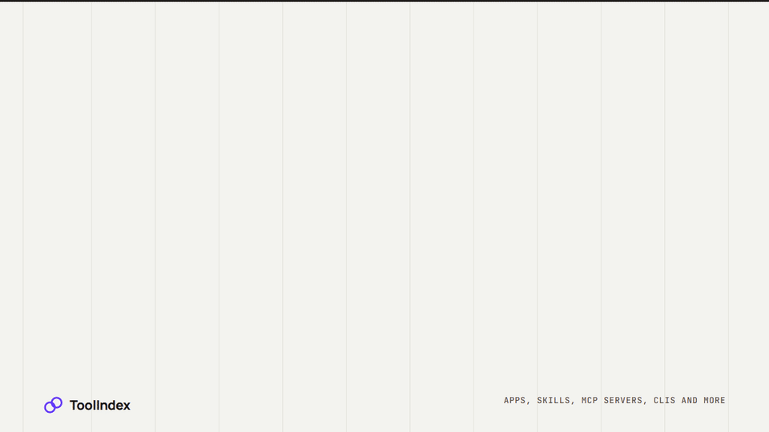

<p align="center"></p>
<h1 align="center">ToolIndex</h1>
<p align="center">Un annuaire gratuit d’outils utiles, où chaque fiche renvoie directement à son code source.<br><sub>Pour qui cherche des apps, des skills, des serveurs MCP, des CLI et plus encore, et pour celles et ceux qui les créent.</sub></p>
<p align="center"><a href="../../../README.md">English</a> · <a href="../es/README.md">Español</a> · <a href="../zh-CN/README.md">简体中文</a> · <a href="../fr/README.md">Français</a> · <a href="../ja/README.md">日本語</a> · <a href="../de/README.md">Deutsch</a> · <a href="../pt-BR/README.md">Português (Brasil)</a></p>

<p align="center"></p>

<p align="center"><a href="https://toolindex.org/"><b>Parcourir les outils</b></a> · <a href="https://toolindex.org/submit/">Soumettre un outil</a> · <a href="https://toolindex.org/developers/">Pour les agents</a></p>

<p align="center"><sub>Votre agent peut le soumettre pour vous via MCP, par exemple depuis</sub><br> Claude &nbsp; <picture><source media="(prefers-color-scheme: dark)" srcset="https://raw.githubusercontent.com/OpenRootdev/toolindex/assets/brands/openai-dark.svg"></picture> Codex &nbsp; <picture><source media="(prefers-color-scheme: dark)" srcset="https://raw.githubusercontent.com/OpenRootdev/toolindex/assets/brands/cursor-dark.svg"></picture> Cursor</p>

## Ce que ça fait

ToolIndex répertorie des outils utilisables par des personnes et des agents IA, des apps pour navigateur aux skills pour agents et aux outils en ligne de commande. Chaque fiche explique comment installer l’outil et renvoie directement à son code source, pour que vous puissiez le vérifier avant d’installer quoi que ce soit.

- **Trouvez vite quelque chose d’utile.** Recherchez, filtrez par type ou triez au hasard, par popularité ou par date.
- **Sachez ce que vous installez.** Chaque page indique les étapes d’installation, la licence et ce que la personne qui a vérifié l’outil a réellement contrôlé.
- **Faites connaître votre outil.** L’inscription est gratuite, et une personne vérifie chaque outil avant sa mise en ligne.

## Soumettez votre outil

1. [Créez un compte gratuit](https://toolindex.org/account/) et choisissez votre nom de créateur.
2. Remplissez le court formulaire : le nom de l’outil, le lien vers son code et la façon de l’installer. Puis cliquez sur **Request review**.
3. Une personne le vérifie. Une fois approuvé, votre outil apparaît dans l’annuaire avec un lien vers votre dépôt.

Pas besoin de fork ni de pull request. Vous suivez la vérification et les retours depuis votre compte.

### Ou demandez à votre agent

Connectez votre agent à cette adresse, une seule fois :

```text
https://toolindex.org/mcp
```

Puis demandez-lui par exemple *« Ajoute mon dépôt à ToolIndex »*. La première fois, votre navigateur s’ouvre pour que vous vous connectiez et autorisiez l’accès. Vous ne collez jamais de mot de passe ni de jeton dans la conversation. Votre agent peut enregistrer des brouillons et demander une vérification, mais il ne peut pas approuver sa propre fiche.

## Parcourir sans compte

Tout ce qui est public se lit librement, par les personnes comme par les agents : sans compte, sans clé d’API et sans JavaScript.

[Site web](https://toolindex.org/) · [Créateurs](https://toolindex.org/people/) · [Catalogue JSON](https://toolindex.org/catalog.json) · [API](https://toolindex.org/api/public/tools) · [llms.txt](https://toolindex.org/llms.txt)

## Ce que contient le dépôt

- [`site/`](../../../site/) · les pages, styles et logos du site
- [`data/listings/`](../../../data/listings/) · un fichier par outil répertorié
- [`backend/`](../../../backend/) · comptes, soumissions, vérification et connexion des agents
- [`scripts/`](../../../scripts/) · construit le catalogue et vérifie chaque fiche
- [`docs/`](../../../docs/) · le fonctionnement de la découverte et du badge communautaire

<sub>Le GIF d’aperçu et les icônes de marque se trouvent sur la branche séparée <code>assets</code> : un clone de <code>main</code> ne contient que le site et son code.</sub>

## Le faire tourner vous-même

```sh
python scripts/catalog.py build
npm ci --prefix backend
npm test --prefix backend
npm start --prefix backend
```

[Backend : comptes, connexion et hébergement](../../../backend/README.md) · [Découverte](docs/discovery.md) · [Contribuer](CONTRIBUTING.md) · [Badges communautaires](docs/badge-program.md)

## Projet frère


**[Harneloop](https://github.com/OpenRootdev/Harneloop)**<br>
Aide un agent IA à apprendre de ce qui n’a pas marché, et ne garde que les améliorations validées par un test.

<br clear="left">

---

<sub>Licence MIT · OpenRootdev</sub>
